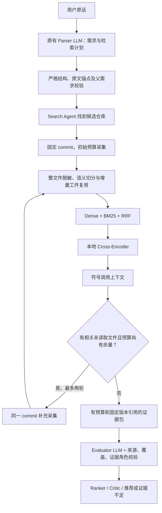

# Repository Deep Research RAG V2

## 本轮契约与决策

用户通过 grill-me 确认以下边界；本轮实现延续此前授权，由助手写代码，开发者随后逐文件阅读。
当前状态是“代码已实现，本地真实模型验收通过，掌握与真实仓库质量评测待完成”。
开发者已于 2026-10-21 授权提交并推送当前 RAG 检查点；不创建版本标签或 Release，不重跑原 baseline。

| 决策 | 本轮实现 |
| --- | --- |
| 本机单用户 | SQLite 持久工件存储，ArtifactStore 接口隔离存储实现；不搭建共享索引服务 |
| 逐步补充源码 | 所有候选都有相同上限，需求相关路径、局部导入和符号上下文用于补充文件 |
| 数据保留 | 仅脱敏片段、向量、版本及索引元数据落盘；绝对 TTL 7 天，SQLite 文件默认最多 1 GiB |
| 语义切分 | Python AST；Tree-sitter JS/JSX/TS/TSX/Java；Markdown 标题；其他语言按行降级 |
| 同次生成计划 | 扩展现有 RequirementParser 调用，不逐仓库另调一个 Query Rewrite LLM |
| 功能判定 | satisfied 同时需要实现和调用/注册/配置接入证据；缺一则 uncertain |
| 首批评测 | 5 个真实仓库、20 条任务；按仓库划分开发/测试集；人工审核前不报告质量结论 |

## 数据流



## 需求计划的可信边界

- `UserRequirements` 和 `RetrievalPlanItem` 禁止额外字段并使用严格类型；任务、表达式长度和数量有上限。
- 使用 `json_mode + include_raw` 读取同一次模型响应，再由程序校验，JSON 格式本身不代表内容真实。
- 每个硬要求、技术、语言和排除条件必须有属于原始输入的逐字引文；没有锚点会拒绝解析，提示需要澄清。
- 计划项的父需求必须精确存在于相应字段中；否定、OR、带版本的父需求不能被拆成另一个原子条件。
- 原始父需求始终保留为查询和最终判断目标。Redis 等改写词可以帮助搜索，但不能新增筛选条件。
- 锚点可靠、检索计划结构或关联不合法时，回退确定性规则；基础需求不可靠时不继续编造需求。
- 原文锚点只能证明来源，不能证明语义解释正确。遗漏、错误解释、引用整段原文掩盖推断等仍需人工样例验证。
- `rag.query_rewrite` 追踪已生成计划转成查询的过程；生成计划的 LLM 调用仍在 parse_requirements Node 内。

## 采集与上下文

默认初始最多 40 个文件、2 MiB；最多补充两轮，每轮 20 次文件尝试。整体硬上限配置为
120 次文件尝试、8 MiB，单文件 128 KiB；100 秒仍是协作式网络截止检查，不是所有计算的进程级强制超时。
初始和补充阶段共享尝试次数、字节预留和原始截止时间，失败尝试也消耗预算。

补充仅访问固定树里的 blob SHA，不重新读取最新 HEAD；查询词、当前命中文件附近路径及本地导入提供候选路径。
覆盖缺口是启发式信号，不等于已证明整个仓库覆盖完整。树截断、限额、错误、补充原因和轮次均保留在报告中。
Java 增加 pom.xml / Gradle 配置支持，排除 .gradle / .m2 缓存及 Maven 凭据配置。

精排后最多保留两个静态符号调用上下文位置，维持最终每需求 5 条证据的预算。
这不是完整的跨语言类型分析或运行时调用图；别名、反射、动态注册等可能仍只能返回 uncertain。
不克隆执行源码，不安装候选仓库依赖，不运行其中测试；找到测试代码不代表测试通过。

## 持久增量工件

- `cache.py`：SQLite 存储，校验 JSON 内容摘要、绝对 TTL 和容量；同一请求的跨线程操作串行化。
- `incremental.py`：文件 blob/content、路径、解析器版本、切分参数、模型和脱敏策略共同决定工件身份。
- 未变化文件复用切分；向量按脱敏 passage 内容和模型版本复用；更改文件只生成缺失向量。
- 引用 ID 始终重新绑定本次 commit，不把旧 SHA 的 citation 搬到新版本。
- 新快照只装配当前文件的片段；删除文件不会继续参与检索。树截断时不把未出现路径推断成删除。
- index.publish 在索引装配后原子写入版本清单；partial 状态保留。统计中的 added/changed/deleted 是树元数据差异。
  空索引或截断树不覆盖上一份成功清单，避免把临时未发现的文件计为删除。
- BM25 全局统计和当前候选矩阵随选中文件集合重新装配；本轮的增量收益主要来自解析、向量计算复用，
  没有实现大型常驻倒排索引的原地更新，也没有共享向量数据库。
- 存储不可用时回退请求内缓存，并记录受控警告；不会让一个候选的缓存错误中断其他候选。

读取不延长保留期。过期工件不可再读，启动、访问、写入和关闭时清理；应用停机时没有后台清理进程。
模型权重不属于仓库缓存，不受其 TTL 和容量限制。缓存支持显式清理：

```powershell
python -m reposcouts.rag.cache --clear
```

## 精排、证据与追踪

精排使用 `BAAI/bge-reranker-v2-m3`，固定 revision
`953dc6f6f85a1b2dbfca4c34a2796e7dde08d41e`；batch 4、输入上限 512 tokens，截断情况记录警告。
RRF 先保留最多 20 个候选给精排，再取 5 个。多检索表达先各自 Dense/BM25 融合，再进行跨表达的排名融合。
分数不是“满足需求的概率”。缺少权重、推理异常或非有限分数时保留 RRF 排名，并明确记录降级。

证据标明 source/example/test/document/config。Evaluator 返回实现、接入、反证各自的 evidence_ids；
程序校验它们的仓库、版本、需求归属、来源类型与静态符号关联。所有独立功能任务均需实现与接入角色。
普通需求不能借示例代码冒充正式实现；明确寻找教程或示例时才允许示例。
文档、许可证、语言等约束使用相应文件依据。not_satisfied 必须有明确反证，不能从检索未命中推断。

`implementation_level` 保留 unknown/declared/dependency/implemented/integrated。结构和符号校验
不能自动证明语义支持，不能证明运行成功；人工 Citation Precision 仍是独立指标。

原有 RunManager 根 Trace 和 Node 回调继承保持不变。新增/扩展阶段包括 query_rewrite、chunking、index、
index.publish、ingestion.expand、dense、bm25、rrf、rerank、context、evidence、judgment。
阶段 Trace 只传计数、ID、版本和错误码；源码、向量通过闭包在进程内传递。
整文件先脱敏再切分、Embedding 和落盘；增加 XML 凭据和 Basic Auth 脱敏。
过滤和正则不能识别所有未知秘密格式，不把持久缓存当作秘密保险箱。

## 评测工作流

`tests/rag/benchmark_v2.json` 已固定五个真实仓库的 SHA，共 20 条待核对任务。
SHA 来自 GitHub API 的元数据读取；当前没有采集完整评测语料、下载模型、调用真实 Evaluator 或填写人工标签。
原 10 条端到端 baseline 文件不变。

1. 代码完成后，开发者决定下载权重；请求路径仍保持 `local_files_only=True`。
2. 准备固定语料及三组候选池，逐条检查源码、引用和标签。
3. 填写 relevance（chunk_id → 0/1/2）、status、rationale、必要的 contradiction_ids 和审核人/日期。
4. 确认三种状态均有覆盖、三路候选池已审阅；冻结时间和 label_status=human_reviewed 后评分。
5. 先在 development 仓库调整，再在保留的 test 仓库进行比较；不要用测试结果反复调参。

以下命令作为后续入口，本轮不执行模型下载与真实评测：

```powershell
python -m reposcouts.rag.download_model --kind all
python tests/run_research_benchmark.py --prepare --mode hybrid_rerank
# 编辑 tests/artifacts/research-benchmark-v2/manifest-for-review.json 完成人工审核
python tests/run_research_benchmark.py --manifest tests/artifacts/research-benchmark-v2/manifest-for-review.json --mode bm25 --split development
python tests/run_research_benchmark.py --manifest tests/artifacts/research-benchmark-v2/manifest-for-review.json --mode hybrid --split development
python tests/run_research_benchmark.py --manifest tests/artifacts/research-benchmark-v2/manifest-for-review.json --mode hybrid_rerank --split development
```

三组固定相同语料、查询和上下文步骤，对比 BM25、Hybrid、Hybrid+Rerank。Hybrid/Rerank 降级时不允许冒充对应实验。
语料以保守字节预算固定，确保所有实验使用同一片段集合；修改切分、语料内容或脱敏策略后需要重新审核。
评测语料也只保留脱敏片段，7 天过期；过期后需从固定 SHA 再准备，不自动使用陈旧工件。
候选池的 annotation-pools.json 提供三路排名、片段与程序生成引用；未知片段按非相关计分，报告明确说明候选池偏差。

检索指标为 Recall@K、MRR、nDCG、Hit Rate；每条含检索耗时，报告保存代码摘要、依赖版本、模型 revision 和配置。
耗时口径是查询检索、精排和上下文，不包含模型加载及索引装配；完整用户请求耗时查看 Agent Trace。

云端判断是单独、显式的收费步骤（本轮未执行）：

```powershell
python tests/run_research_benchmark.py --manifest tests/artifacts/research-benchmark-v2/manifest-for-review.json --mode hybrid_rerank --judge --tracing --output tests/artifacts/research-benchmark-v2/predictions.json
```

--judge 只把任务和检索证据传给现有 Evaluator，不能把 gold 传给模型。
--tracing 用项目脱敏 Client 为每个判断创建根 Trace，输出保留 trace_id；默认独立项目
reposcouts-rag-evaluation-v2（可用 --project 指定），未指定追踪时显式禁用隐式全局追踪。
此入口追踪判断阶段；完整采集/检索树通过正常 Agent 请求验收。
评分命令可以用 --predictions 加载实际判断，计算 Accuracy/Macro F1。
Citation Precision 另需 --citation-review：reviewed_by、reviewed_at、predictions_digest，以及
labels=[{task_id,evidence_id,supports:true/false}]；摘要绑定本次预测，防止旧人工标签套用新结果。
没有独立人工引用支持标签时，Citation Precision 保持 null；不据此推算模型费用。

## 阅读与验证顺序

1. core/schemas.py、rag/schemas.py、rag/planning.py、stages/requirement_parser.py：需求和可信边界。
2. rag/semantic.py、rag/chunking.py：语法树如何转为保持原始行号的片段。
3. rag/cache.py、rag/incremental.py、rag/index_cache.py：持久工件与请求内索引的区别。
4. rag/github_source.py、rag/context.py、rag/service.py：预算、扩展采集和调用链。
5. rag/retrieval.py、rag/reranking.py、rag/evidence.py、rag/grounding.py、stages/repository_evaluator.py：检索到判断。
6. rag/benchmark.py、tests/run_research_benchmark.py、tests/test_rag_v2.py、tests/test_research_benchmark.py：验收边界。

requirements.txt 删除了误放的 shell 安装命令，新增四个解析依赖；不会触发权重下载。
技能的开发者手写和掌握环节按此前要求延后，不设新的问答门禁，不伪造已掌握或正式发布状态。

参考：[模型官方说明](https://huggingface.co/BAAI/bge-reranker-v2-m3)、
[CrossEncoder 官方接口](https://www.sbert.net/docs/package_reference/cross_encoder/model.html)、
[Tree-sitter Python 官方接口](https://tree-sitter.github.io/py-tree-sitter/)。

## 本轮验证记录（2026-10-20）

- 全量 134 项 unittest 通过，包括 API、原有观测/基线、真实解析器、增量缓存、失败恢复和新评测契约。
- 测试阻断外部 socket 与 requests HTTP，只允许 Windows 事件循环所需本机连接；没有调用真实业务模型。
- Python 语法解析、git diff --check、pip check 通过。CrossEncoder 所需参数已对照当前安装版本接口核对。
- Tree-sitter 实装版本：0.26.0；Java 0.23.5；JavaScript 0.25.0；TypeScript 0.23.2。
- 仅为清单读取了五个公开仓库的版本元数据，没有执行完整业务请求、下载权重或改动原 10 条 baseline。
- 人工标签、真实 Hybrid/Reranker 效果、GPU 内存/时延及真实 Agent→LangSmith 新链路仍待验收。
- 代码和文档保留在工作区，未创建本轮 Git commit、标签或 Release；掌握验证按开发者要求延后。

## 本地模型验收与提交检查（2026-10-21）

以下记录更新上面的历史状态，不代表真实仓库质量评测已经完成。

- 开发者已自行下载两套固定 revision 权重；验收阻断网络，使用项目 models/ 下的缓存，网络请求尝试为 0。
- E5 与 BGE Reranker 均在 RTX 4060 上以 FP32 完成真实推理；E5 输出 384 维单位向量，精排评分有限且未降级。
- 10 条中英文合成冒烟查询的 Dense 与 Reranker 首位文件均命中预期；这些是小型功能样例，不是人工标注 Benchmark。
- Hybrid → RRF → Reranker → Evidence、同请求索引复用及检索阶段原生回调通过；没有调用云端 LLM、GitHub 或 LangSmith。
- 超长 Embedding 查询被显式拒绝；超长 Reranker 输入会记录 reranker_input_truncated 警告。
- 两模型同时加载并推理期间峰值已分配显存为 2,774,424,064 bytes（约 2.58 GiB），不代表真实大仓库负载的上限。
- 推送前重新运行全量 134 项 unittest，全部通过，无跳过；Python/JSON 语法检查、pip check 和 diff 格式检查通过。
- 权重、持久缓存、原始验收 JSON 和测试日志保留本地并由 .gitignore 排除；本次提交保留代码、测试、评测清单和设计文档。
- 人工标签、真实仓库检索效果、完整 Agent → LangSmith 新链路和开发者掌握验证仍待完成。
